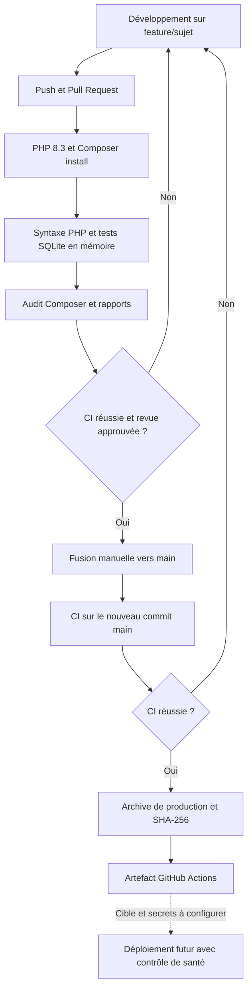

# DevOps — TexTileCycle

## Définition et périmètre

DevOps associe développement et exploitation pour livrer des versions vérifiables, reproductibles et observables. Dans TexTileCycle, Git et les Pull Requests organisent le travail, la CI contrôle chaque proposition et la préparation de release fournit un livrable identifié par son commit.

La logique métier des modules Dépôts, Ateliers, Associations/Dons et Upcycling reste inchangée. Les fichiers DevOps sont `.github/workflows/ci.yml`, `.github/ci/bootstrap.php` et cette documentation. Les assets sont déjà précompilés dans `public/` : aucun outil de compilation JavaScript ni CDN n’est nécessaire.

## Stratégie des branches et développement

- `main` contient la version intégrée. On y fusionne des Pull Requests relues et validées.
- `feature/<sujet>` contient une évolution ciblée, par exemple `feature/devops-pipeline`.
- Chaque membre conserve les autres modules et vérifie son diff avant de proposer sa contribution.

Avant de commencer :

```powershell
git status
git switch main
git pull --ff-only origin main
git switch -c feature/mon-sujet
```

Si des modifications locales sont présentes, les préserver avant tout changement de branche. Ne pas réinitialiser les fichiers pour résoudre un problème de synchronisation. En cas de divergence, comparer les historiques et décider de la fusion avec les contributeurs.

Le développement se fait avec PHP 8.3, Composer 2 et les extensions de l’application. `composer install` réutilise `composer.lock` ; la CI ne met pas les dépendances à jour automatiquement. Ne pas copier un fichier `.env` personnel dans une PR.

## Pull Request et merge vers main

1. Préparer des changements ciblés sur la branche de travail.
2. Exécuter les tests et relire `git diff --check` et `git diff --name-status`.
3. Après autorisation, créer un commit et pousser cette branche.
4. Ouvrir une PR vers `main` avec le comportement attendu et les validations réalisées.
5. Attendre la CI, relire les fichiers modifiés et vérifier les conflits.
6. Faire relire puis fusionner la PR. Aucun job de ce pipeline ne fusionne une PR.

Il est recommandé de rendre le job « PHP 8.3 - syntaxe, tests et audit » obligatoire dans une règle de protection de `main`. Cette règle se configure dans les paramètres GitHub ; elle n’est pas créée par le fichier YAML.

## Intégration continue

Le workflow se déclenche sur tous les `push`, sur les événements usuels `pull_request` et manuellement avec `workflow_dispatch`. Il utilise un runner GitHub `ubuntu-latest`, un token limité à `contents: read` et des jobs limités dans le temps. Les anciennes exécutions d’une même référence sont annulées lorsqu’une nouvelle commence.

Le job `ci` effectue :

| Étape | Fonction |
|---|---|
| Checkout | Récupérer le code, sans conserver les identifiants Git dans le checkout |
| PHP et Composer | PHP 8.3, Composer 2, SQLite, GD et les extensions nécessaires |
| Dépendances | Valider Composer, installer les versions verrouillées et vérifier les extensions |
| Environnement | Copier `.env.example` sur le runner et générer une APP_KEY éphémère |
| Syntaxe | Exécuter `php -l` sur `artisan` et les fichiers PHP applicatifs, de tests et du bootstrap CI |
| Tests | Exécuter `php artisan test` sur SQLite en mémoire avec le bootstrap CI |
| Audit | Exécuter `composer audit --locked` sur les dépendances, y compris de développement |
| Rapports | Conserver le rapport JUnit, la syntaxe et l’audit pendant 14 jours |
| Bilan | Afficher le résultat de chaque contrôle dans le résumé GitHub Actions |

Une erreur de syntaxe, de test, d’installation ou d’audit fait échouer le job. L’audit est également tenté après un échec de test si les dépendances ont été installées. Une impossibilité de joindre le service d’audit est signalée comme un échec : le pipeline ne la présente pas comme une absence de vulnérabilité.

Les rapports disponibles sont publiés même après un échec. Aucun artefact de release n’est créé si la CI échoue.

## Tests automatisés et sécurité de la base

`phpunit.xml` impose déjà `DB_CONNECTION=sqlite`, `DB_DATABASE=:memory:` et une URL de base vide. Le job utilise aussi ces valeurs, active les clés étrangères et configure sessions/cache en mémoire, mails en tableau et file de tâches synchrone. Les tests utilisent leurs simulations Ollama : aucun modèle, serveur IA, SMTP ou service MySQL n’est requis sur GitHub.

La suite couvre tous les modules, l’authentification, les permissions, le CRUD, les uploads, les validations, les favoris, la modération et les contrats IA simulés. SQLite ne remplace pas une vérification de compatibilité avec la base du futur serveur. Les générations réelles Ollama restent des démonstrations locales distinctes.

Certains tests utilisent le trait Laravel `RefreshDatabase`, dont la préparation par défaut réinitialise la base. Pour respecter l’interdiction de migrations destructives, `.github/ci/bootstrap.php` charge ce trait avec une seule substitution **en mémoire** : la préparation lance uniquement `migrate`, après avoir vérifié qu’il s’agit exactement de SQLite `:memory:`. Les fichiers vendor, les tests et les modules restent inchangés.

Le bootstrap refuse de fonctionner si Laravel change le fragment attendu ou si une base persistante est sélectionnée. Cette garde doit être revue lors d’une mise à jour du framework. Le trait Upcycling existant conserve sa propre garde équivalente. Aucun seeding de production n’est exécuté.

Les photos de test nécessitent `memory_limit=512M`, réglé par `setup-php`. Le jeton `TEST_TOKEN` isole le disque de fichiers de test de chaque exécution ; les uploads réels ne sont pas utilisés.

Commande de contrôle, depuis la racine :

```powershell
php artisan test --bootstrap=.github/ci/bootstrap.php
composer audit --locked --no-interaction
git diff --check
```

L’option de bootstrap est importante : ne pas lancer la suite sans elle dans cette procédure. Vérifier avec `php --ini` que le PHP enfant dispose bien de 512 Mo. Une option `php -d memory_limit=512M artisan test` seule ne règle pas nécessairement le processus PHPUnit enfant.

Pour une démonstration Windows sans changer le `php.ini` de Wamp, utiliser un INI temporaire et restaurer les variables ensuite :

```powershell
$ciIniDirectory = Join-Path $env:TEMP ('textilecycle-ci-' + [guid]::NewGuid().ToString('N'))
New-Item -ItemType Directory -Path $ciIniDirectory | Out-Null
Set-Content -LiteralPath (Join-Path $ciIniDirectory '99-ci.ini') -Value 'memory_limit=512M' -Encoding ASCII
$previousIniScan = $env:PHP_INI_SCAN_DIR
$previousTestToken = $env:TEST_TOKEN
try {
    $env:PHP_INI_SCAN_DIR = $previousIniScan + ';' + $ciIniDirectory
    $env:TEST_TOKEN = 'ci-' + [guid]::NewGuid().ToString('N')
    php artisan test --bootstrap=.github/ci/bootstrap.php
} finally {
    $env:PHP_INI_SCAN_DIR = $previousIniScan
    $env:TEST_TOKEN = $previousTestToken
}
```

Ne pas utiliser de base persistante pour ces tests. La CI crée son `.env` uniquement sur le runner ; votre `.env` local n’a pas à être remplacé.

## Livraison continue préparée

Après un **push sur `main`** dont le job `ci` a réussi, le job `release` construit un artefact. Une PR, un push sur une branche de travail ou une exécution manuelle lance la CI sans préparer de release.

Le job exporte les chemins applicatifs versionnés du commit validé dans un dossier temporaire. Il installe les dépendances de production avec `composer install --no-dev`, vérifie la plateforme puis génère :

- `textilecycle-<SHA>.tar.gz` : code des quatre modules, migrations, ressources, assets locaux précompilés, arborescence de stockage et dépendances de production ;
- `textilecycle-<SHA>.tar.gz.sha256` : empreinte pour vérifier l’intégrité ;
- `release.json` et `RELEASE.json` dans l’archive : commit, exécution GitHub et version PHP.

L’artefact `textilecycle-release-<SHA>` est conservé 30 jours dans GitHub Actions. Il inclut `.env.example` et les règles `.htaccess` versionnées, mais pas le vrai `.env`, `.git`, les bases, les photos déposées, les logs, les fichiers temporaires de tests ou les dépendances de développement. Il ne contient pas de configuration Laravel mise en cache avec des valeurs privées.

L’archive fournit un livrable et une préparation de livraison continue. **Aucun déploiement sur un serveur et aucune GitHub Release publique ne sont exécutés.** Il n’y a pas de cible de déploiement configurée dans ce pipeline.

## Déploiement continu : informations manquantes

Pour déployer réellement, il faut définir avec l’équipe :

1. La cible : hébergeur, serveur, conteneur ou plateforme, et méthode de transfert/API.
2. Le domaine, HTTPS et la racine web `public/`.
3. Le runtime : PHP et extensions, serveur web, droits sur `storage/` et `bootstrap/cache/`.
4. La base cible, son accès, ses sauvegardes et la validation préalable des migrations additives.
5. Les fichiers persistants et photos, le stockage partagé, les tâches planifiées et les workers de file.
6. La configuration des mails et des services externes réellement activés.
7. Pour l’IA : une instance Ollama accessible de façon appropriée depuis le serveur et les modèles attendus ; `127.0.0.1` désigne le serveur lui-même, pas l’ordinateur du développeur.
8. Les identifiants de déploiement, approbations, contrôle de santé et procédure de retour arrière.

Une future étape pourra télécharger l’artefact validé, vérifier son empreinte, créer une nouvelle version sur la cible, injecter la configuration privée, préparer les liens de stockage et basculer après un contrôle de santé. Les migrations devront être relues et sauvegardées ; aucune réinitialisation destructive n’est prévue.

## Gestion des secrets

La CI et l’assemblage d’artefact n’utilisent aucun mot de passe de serveur. La clé générée pour les tests est jetable et n’est ni publiée dans les rapports ni emballée dans l’archive.

Pour le futur déploiement, utiliser les secrets d’un environnement GitHub protégé ou le gestionnaire de secrets de l’hébergeur, avec approbation si nécessaire. Les noms dépendront de la cible : accès SSH ou API, paramètres de base, APP_KEY stable de production et paramètres de messagerie. Ne pas inventer de valeurs et ne jamais les écrire en clair dans le dépôt, les commandes de démonstration, les logs ou l’artefact.

La clé de production doit être conservée entre déploiements, et non régénérée à chaque livraison. Un changement de clé peut rendre des données chiffrées existantes inutilisables.

## Diagramme



## Procédure de démonstration

1. Montrer `git status`, la branche et les fichiers DevOps. Vérifier que les modules métier n’ont pas changé.
2. Montrer les déclencheurs et les jobs de `ci.yml`, puis les variables SQLite et le bootstrap protégé.
3. Exécuter les commandes locales ci-dessus avec la mémoire nécessaire. Montrer le résultat global et `composer audit`.
4. Après autorisation de commit/push, publier la branche et ouvrir une PR vers `main`. Cette implémentation ne réalise pas ces actions automatiquement.
5. Dans **Actions**, ouvrir « Laravel CI et release », détailler les étapes puis le résumé et les rapports JUnit/audit/syntaxe.
6. Pour illustrer un échec, utiliser une branche de démonstration distincte et un changement volontaire contrôlé ; ne pas casser `main` ni les modules partagés. La CI doit bloquer la préparation de release.
7. Après revue et fusion autorisée, ouvrir l’exécution déclenchée par le push sur `main`. Montrer que `release` dépend de `ci`.
8. Télécharger l’artefact, vérifier l’empreinte (`sha256sum -c` sous Linux ou `Get-FileHash -Algorithm SHA256` sous PowerShell), lire `release.json` et constater l’absence de `.env` et de données utilisateur.
9. Expliquer que la livraison d’une archive est prête, tandis que le déploiement attend la cible, les secrets et l’exploitation décrits plus haut.

Tant que ces fichiers ne sont pas publiés, leur validation est locale : aucune exécution GitHub Actions n’a encore été déclenchée pour cette branche.

## Vérification initiale de cette branche

- `php artisan test --bootstrap=.github/ci/bootstrap.php` : 644 tests, 4 452 assertions réussies, avec l’INI temporaire à 512 Mo.
- `composer validate --strict --no-check-publish` : valide.
- `composer audit --locked --no-interaction --format=json` : aucune vulnérabilité ni dépendance abandonnée signalée lors du contrôle.
- Syntaxe de 246 fichiers PHP : aucune erreur.
- YAML, syntaxe des 9 étapes shell et `actionlint` 1.7.12 : valides.
- Assemblage réel de la release vérifié dans un dossier temporaire : archive d’environ 14 Mo, dépendances de production, quatre modules et empreinte SHA-256 corrects, sans configuration privée ni données utilisateur.

Ces contrôles locaux ne prétendent pas remplacer la première exécution sur le runner Ubuntu après publication. Le workflow n’a pas encore été poussé et aucun serveur n’a reçu cette archive.

## Références

- [GitHub Actions : syntaxe des workflows](https://docs.github.com/en/actions/writing-workflows/workflow-syntax-for-github-actions)
- [setup-php : PHP, extensions et Composer](https://github.com/shivammathur/setup-php)
- [Composer : audit des dépendances](https://getcomposer.org/doc/03-cli.md#audit)
- [upload-artifact : conservation et téléchargement des artefacts](https://github.com/actions/upload-artifact)
- [actionlint : vérification statique des workflows](https://github.com/rhysd/actionlint)
