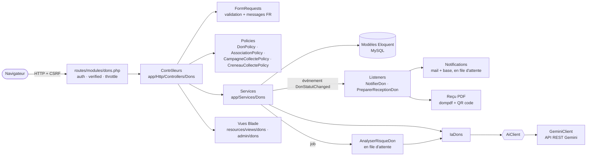
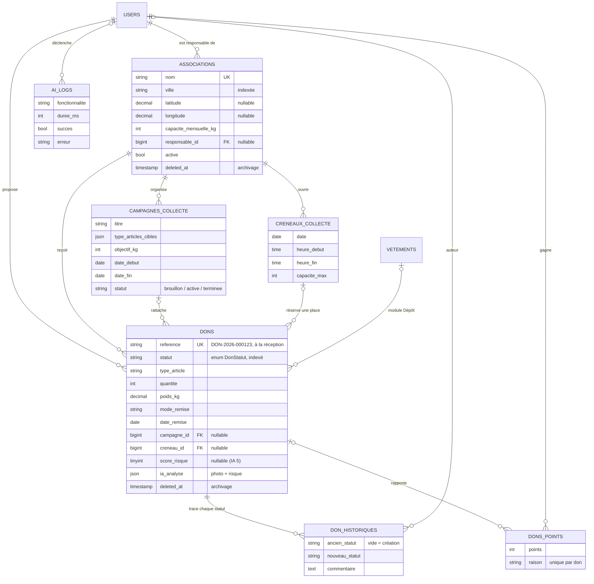
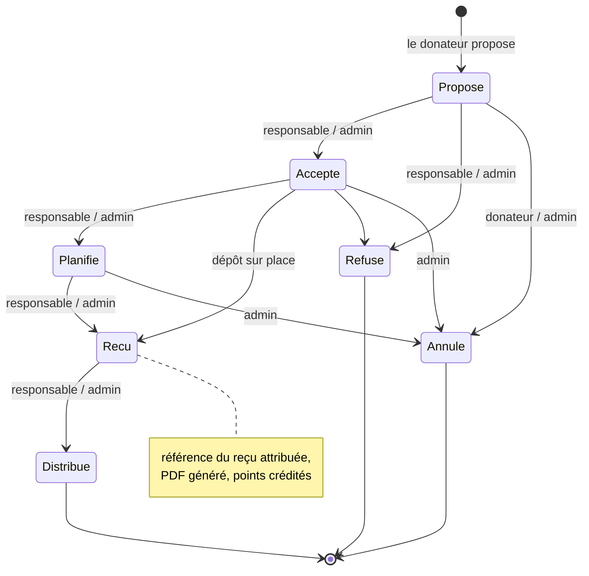
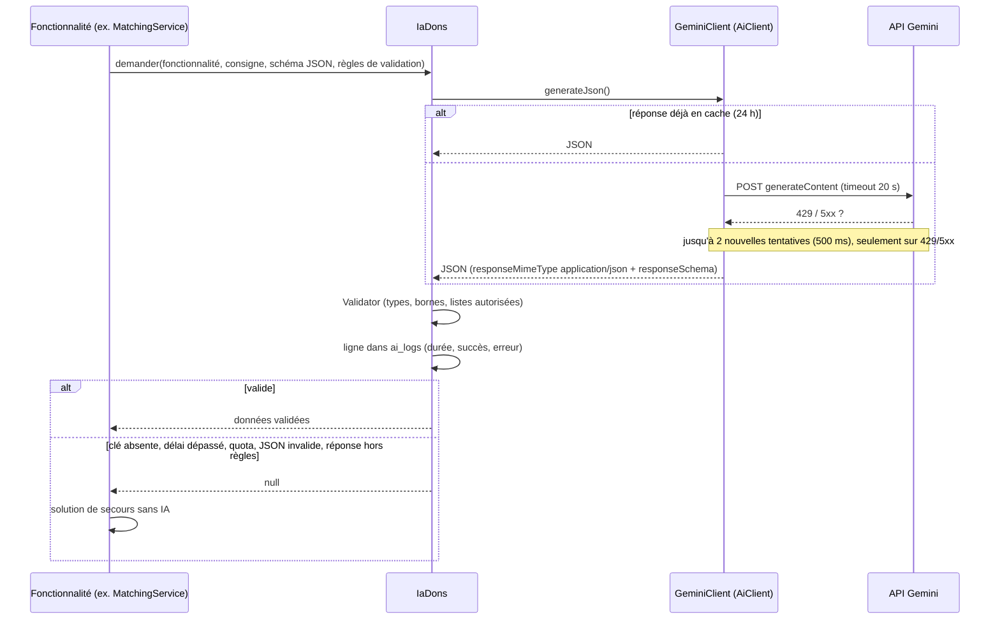

# Module « Associations & dons » — TexTileCycle

Ce module permet à un particulier de **donner ses textiles à une association partenaire**, et à l'association de **traiter ces dons** de la proposition jusqu'à la distribution. Il ajoute des campagnes de collecte, des créneaux de collecte à domicile, un reçu PDF vérifiable, des notifications, un calcul d'impact environnemental, de la gamification, un tableau de bord et cinq fonctionnalités d'intelligence artificielle (Google Gemini).

> **Fil conducteur de l'architecture** : *une seule porte d'entrée pour chaque règle métier.*
> Le statut d'un don ne change que par `DonWorkflowService`, les droits ne se décident que dans les *policies*, et l'IA n'est appelée qu'à travers `IaDons` (validation + journal + solution de secours).

---

## 1. Les acteurs

| Acteur | Ce qu'il peut faire |
|---|---|
| **Visiteur** | Parcourir les associations (liste, carte, « près de moi »), les campagnes, le classement ; vérifier un reçu (QR code) ; poser une question à l'assistant IA. |
| **Donateur** (compte vérifié) | Proposer un don (analyse photo et associations recommandées par l'IA), suivre ses dons et leur historique, annuler un don encore « Proposé », télécharger ses reçus, consulter son impact, ses points et ses badges, recevoir des notifications. |
| **Responsable d'association** | Dans l'« Espace association » : traiter les dons reçus (accepter, refuser, planifier, réceptionner, distribuer), ouvrir des créneaux de collecte, mettre à jour la présentation de l'association et générer un rapport mensuel (avec l'IA). |
| **Administrateur** | Tout le back office : associations, campagnes, dons, tableau de bord, exports Excel/CSV, dons « À vérifier », journal IA. |

---

## 2. Architecture en couches



Règles d'organisation suivies :

- **Routes** : uniquement dans `routes/modules/dons.php` (front `/dons/...`, back office `/admin/dons/...`).
- **Vues** : `resources/views/dons/` (site), `resources/views/dons/espace/` (Espace association), `resources/views/admin/dons/` (back office).
- **Contrôleurs minces** : ils valident (FormRequest), autorisent (`$this->authorize`) puis délèguent aux services.
- **Enums PHP** (`app/Enums/Dons`) : `DonStatut`, `TypeArticle`, `EtatGeneral`, `ModeRemise`, `StatutCampagne`, avec `label()` et `color()`. Les colonnes sont castées en enums dans les modèles.

---

## 3. Entités et relations



Points à retenir :

- **Archivage (soft delete)** des associations et des dons : un don garde le nom de son association même archivée (`withTrashed()` sur la relation).
- **Index** : `dons(statut)`, `dons(association_id, statut)`, `associations(ville)`, `campagnes_collecte(statut, date_fin)`, `creneaux_collecte(association_id, date)`.
- `ia_analyse` et `score_risque` ne sont **jamais remplissables par un formulaire** (absents de `$fillable`) : seul le serveur y écrit.

---

## 4. Cycle de vie d'un don (machine à états)



- Les transitions autorisées sont définies **une seule fois** : `DonStatut::allowedTransitions()`.
- `DonWorkflowService::transition()` relit le don **sous verrou** (`lockForUpdate`) dans une transaction, refuse une transition interdite (`InvalidDonTransitionException`, message en français, jamais d'erreur 500), écrit l'historique, puis émet l'événement `DonStatutChanged` **après validation de la transaction**.
- **Qui fait quoi** est décidé par `DonPolicy` : l'administrateur peut tout (mais reste soumis à la machine à états), le donateur ne peut qu'annuler son don tant qu'il est « Proposé », le responsable traite les dons de **son** association. Les boutons affichés sont l'intersection des deux (transition possible **et** autorisée).

---

## 5. Les services

| Service | Rôle |
|---|---|
| `DonWorkflowService` | `proposer()` : crée le don (réserve la place du créneau sous verrou, enregistre l'analyse photo, lance l'analyse de risque). `transition()` : change le statut (voir §4). |
| `RecuDon` | Génère le reçu PDF (dompdf) avec un QR code SVG vers `/dons/verifier/{référence}`, stocké sur le disque **privé**. |
| `ImpactCalculator` | CO₂ et eau évités par kilo reçu (coefficients dans `config/textilecycle.php`) : par don, par utilisateur, global (cache 10 min). |
| `BadgeService` | Points (+10 par kg reçu, une seule fois par don), badges calculés (Premier don, 10 kg, 50 kg, Fidèle = 5 dons), classement top 10 (prénom seulement). |
| `StatistiquesDons` | Indicateurs et graphiques du tableau de bord (cache 10 min). |
| `MatchingService` | Associations recommandées (règles + IA). |
| `Ia\IaDons` | Passage obligé de toutes les fonctionnalités IA (voir §7). |
| `Ia\AnalysePhotoDon`, `Ia\AssistantDonateur`, `Ia\RedactionIa`, `Ia\DetecteurRisque` | Les fonctionnalités IA 1, 3, 4 et 5. |

Autres briques : **listeners** `NotifierDon` (notifications) et `PreparerReceptionDon` (reçu + points) ; **job** `AnalyserRisqueDon` ; **commande planifiée** `dons:cloturer-campagnes` (chaque nuit) ; **export** `DonsExport` (maatwebsite/excel, mêmes filtres que l'écran grâce au scope `Don::filtrer()`).

---

## 6. Fonctionnalités métier

| Fonctionnalité | Comment c'est fait |
|---|---|
| **Campagnes de collecte** | Objectif en kg sur une période. La jauge ne compte que les kilos **réellement reçus** (statuts Reçu/Distribué) via `withSum`. Les campagnes expirées passent en « Terminée » chaque nuit. |
| **Créneaux de collecte** | Pour une collecte à domicile, le donateur choisit un créneau disponible. **Anti-surréservation** : la place est vérifiée une 2ᵉ fois dans une transaction, avec le créneau verrouillé (`lockForUpdate`). Un don refusé/annulé libère sa place. |
| **Reçu PDF + QR code** | Référence unique `DON-AAAA-000123` attribuée à la réception. Page publique de vérification limitée (30/min) et minimaliste (prénom seulement). |
| **Notifications** | Mail + base de données, envoyées en file d'attente ; cloche avec compteur dans le menu du site. |
| **Impact & gamification** | Page « Mon impact », chiffres globaux sur la page d'accueil du module, classement public. |
| **Tableau de bord admin** | KPI (kg reçus, dons du mois, taux d'acceptation, associations actives) + graphiques Chart.js, requêtes en cache 10 min. |
| **Export** | Excel et CSV de la liste filtrée. |
| **Carte** | Leaflet + OpenStreetMap ; filtre « près de moi » (géolocalisation du navigateur + formule de **Haversine** dans le scope `Association::procheDe()`). |

---

## 7. L'intelligence artificielle (Google Gemini)

### 7.1 Une architecture prévue pour l'échec



| Garantie | Où |
|---|---|
| **Interface** `App\Contracts\AiClient`, liée à `GeminiClient` dans `AiServiceProvider` (remplaçable en test) | `app/Contracts`, `app/Providers` |
| **API REST** via le client HTTP de Laravel, sans SDK ; clé, modèle et délai dans `config/services.php` (`GEMINI_API_KEY`, `GEMINI_MODEL`) | `app/Services/Ai/GeminiClient.php` |
| **Sortie JSON contrainte** : `responseMimeType: application/json` + `responseSchema` | idem |
| **Délai** 20 s, **nouvelles tentatives** 2 × 500 ms sur 429/5xx seulement | idem |
| **Cache** 24 h des demandes identiques (empreinte SHA-256 de la consigne, du schéma et de l'image) | idem |
| **Journal** dédié `storage/logs/ai.log` (jamais la clé, la consigne ni l'image) + table `ai_logs` (page « Journal IA » avec taux de réussite) | `config/logging.php`, `AiLog` |
| **Validation** de chaque réponse par `Validator` avant usage | `IaDons` |
| **Jamais d'erreur 500** : toute panne donne `null`, chaque fonctionnalité a sa version sans IA | `IaDons` + chaque service |
| **Limite** : 10 requêtes IA par minute et par compte (par IP pour un visiteur) | `routes/modules/dons.php` |
| **Sécurité d'affichage** : les textes de l'IA sont insérés avec `textContent`, jamais en HTML | vues `dons/partials/ia-*` |

### 7.2 Les cinq fonctionnalités

#### IA 1 — Analyse de la photo du don
- **Où** : formulaire « Faire un don ». Après le choix d'une photo, appel AJAX `POST /dons/ia/analyser-photo` ; l'image est envoyée à Gemini en base64.
- **Consigne** : « Analyse cette photo d'un don de textiles destiné à une association caritative. Indique s'il s'agit bien de textiles (vêtements, chaussures, linge de maison, accessoires textiles). Si oui, choisis le type d'article et l'état général parmi les valeurs autorisées, estime le nombre d'articles visibles, leur poids total en kilogrammes, et décris le lot en une phrase courte en français. confiance est ta certitude globale entre 0 et 1. »
- **Réponse attendue** : `est_textile`, `type_article` (enum), `etat_general` (enum), `quantite_estimee` (1–500), `poids_estime_kg`, `description_courte`, `confiance` (0–1).
- **Usage** : les champs sont pré-remplis avec un badge « ✨ suggéré par l'IA », modifiables. Si `est_textile` est faux, un avertissement s'affiche et l'envoi est **bloqué** (aussi côté serveur). Le résultat est gardé côté serveur sous un **jeton** lié au compte, puis enregistré dans `dons.ia_analyse` : le navigateur ne peut pas le falsifier. La photo n'est pas conservée.
- **Secours** : « L'analyse automatique est indisponible pour le moment : remplissez le formulaire vous-même. »

#### IA 2 — Associations recommandées (matching)
- **Étape 1, règles (0 à 60)** : même ville +25, association active +10, capacité mensuelle restante +15, campagne en cours qui cible ce type d'article +10.
- **Étape 2, IA (0 à 40)** : les 8 meilleures candidates (id, nom, ville, besoins) et la description du don sont envoyées à Gemini. Consigne : « Pour CHAQUE association, donne score_semantique (entier de 0 à 40) : à quel point ses besoins correspondent à ce don. Ajoute une justification d'une phrase en français, sans inventer d'information absente des besoins. »
- **Validation** : chaque `id` renvoyé doit faire partie des candidates (une association inventée invalide la réponse).
- **Usage** : score final = règles + sémantique ; les 3 meilleures associations actives s'affichent en cartes, avec score et justification.
- **Secours** : score des règles seul, message « Recommandation simplifiée ».

#### IA 3 — Assistant des donateurs
- **Où** : bulle de discussion sur les pages du module (`POST /dons/ia/assistant`), ouverte aux visiteurs.
- **Contexte (RAG simple)** : extrait de la base selon la ville et les mots-clés de la question — associations actives, besoins, ville, campagnes en cours ; 15 lignes au plus. Les 6 derniers messages sont gardés en session.
- **Consigne système** : répondre en français, **uniquement à partir du contexte**, dire « je ne sais pas » sinon, citer le nom exact des associations (et leurs identifiants), et mettre `hors_sujet` à vrai pour une question sans rapport avec les dons, en refusant poliment.
- **Validation** : les identifiants cités doivent appartenir au contexte : un lien ne peut pas être inventé.
- **Secours** : « L'assistant est momentanément indisponible. Voici des associations partenaires qui pourraient correspondre à votre question : » + liens.

#### IA 4 — Aide à la rédaction
- **Où** : boutons « Générer avec l'IA » dans le back office (description d'association, texte de campagne, rapport mensuel) et dans l'Espace association (présentation, rapport mensuel).
- **Consigne système** : « Tu rédiges des textes pour une plateforme tunisienne de dons de textiles à des associations. Écris en français clair et chaleureux, sans exagération ni information inventée : n'utilise que les faits fournis. Pas de titre, pas de markdown, pas d'émojis. »
- Le **rapport mensuel** est construit à partir des **vrais chiffres** du mois (dons reçus, kg, types, CO₂ et eau évités).
- **Rien n'est enregistré automatiquement** : le texte apparaît dans le champ pour relecture.
- **Secours** : modèle de texte rempli avec les données (campagne, rapport) ; message pour la description.

#### IA 5 — Détection d'anomalies
- **Où** : job `AnalyserRisqueDon`, lancé en file d'attente à chaque don proposé par un donateur.
- **Règles (score 0 à 100)** : quantité > 200 (+30), poids par article irréaliste (+25), plus de 3 dons en 24 h (+25), doublon dans l'heure (+30), message vide (+5) ou ressemblant à du spam (+20).
- **IA** : à partir de 40, Gemini rédige une explication courte et factuelle pour l'administrateur (« n'accuse pas le donateur »), stockée dans `ia_analyse.risque`.
- **Usage** : badge rouge « À vérifier » et filtre dans la liste des dons du back office.
- **Secours** : l'explication reprend les règles déclenchées.

---

## 8. Sécurité et qualité

| Point | Mise en œuvre |
|---|---|
| **Autorisation** | `$this->authorize()` dans chaque action ; 4 policies ; le back office est en plus réservé aux administrateurs par un middleware global. Les pages publiques (associations, campagnes, classement, vérification de reçu, assistant) le sont volontairement. |
| **Validation** | Une FormRequest (ou une validation explicite) par formulaire, messages en français, enums validés avec `Rule::enum`. |
| **CSRF** | `@csrf` dans chaque formulaire POST ; en-tête `X-CSRF-TOKEN` sur chaque appel AJAX. |
| **XSS** | Aucun `{!! !!}` dans le module ; textes IA et noms d'associations insérés en `textContent` ; site web limité à `http(s)`. |
| **Téléversements** | Logo et image de campagne : JPG/PNG/WebP (pas de SVG), 2 Mo max, nom aléatoire, disque `public` = `storage/app/public` (servi via `php artisan storage:link`). Reçus PDF sur le disque **privé**. Photo pour l'IA : 5 Mo max, jamais conservée. |
| **Limites de débit** | Formulaire de don : 5/min par compte ; IA : 10/min ; vérification de reçu : 30/min. |
| **Concurrence** | `lockForUpdate` sur les transitions de statut et sur les créneaux. |
| **Performance** | Chargement anticipé (`with`, `withSum`, `withCount`) — un test charge les 29 pages du module avec `Model::preventLazyLoading()` : aucune requête N+1 ; statistiques en cache 10 min. |
| **Vie privée** | Classement et page de vérification : prénom seulement ; journal IA sans contenu échangé. |

---

## 9. Lancer le projet

```bash
composer install
cp .env.example .env              # puis renseigner la base MySQL et, pour l'IA, GEMINI_API_KEY
php artisan key:generate
php artisan migrate
php artisan storage:link          # rend storage/app/public accessible (logos, images de campagne)
php artisan db:seed --class=DonsSeeder   # 5 associations du Grand Tunis, campagnes, créneaux, dons
php artisan serve
```

Dans deux autres terminaux :

```bash
php artisan queue:work            # notifications et analyse de risque (IA 5)
php artisan schedule:work         # clôture nocturne des campagnes expirées
```

Comptes de démonstration (mot de passe `password`) : `test@example.com` (administrateur, créé par `DatabaseSeeder`), `responsable@example.com` (responsable d'association, créé par `DonsSeeder`).

**Sans clé Gemini**, tout fonctionne : chaque fonctionnalité IA utilise sa version de secours (la page « Journal IA » l'indique).

**Tests** :

```bash
php artisan test tests/Feature/Dons
```

264 tests : workflow et policies (76), validation (24), campagnes et créneaux (22), reçus (8), notifications (7), impact et gamification (6), tableau de bord, export et carte (9), IA avec Gemini simulé par `Http::fake` — succès, JSON invalide, délai dépassé, quota 429 (67), revue : N+1, états vides, téléversements (45).

---

## 10. Scénario de démonstration (oral)

1. **Visiteur** — `/dons` : chiffres d'impact, carte, bouton « 📍 Près de moi » ; poser à l'assistant « Qui a besoin de manteaux à Ariana ? » puis une question hors sujet.
2. **Donateur** — « Faire un don » : choisir une photo → champs pré-remplis « suggéré par l'IA » ; choisir sa ville → 3 associations recommandées avec justification ; choisir une collecte à domicile et un créneau ; envoyer.
3. **Responsable** (`responsable@example.com`) — Espace association : accepter, planifier, marquer « Reçu » → le donateur reçoit une notification (cloche), le reçu PDF est disponible, le QR code ouvre la page de vérification ; générer le rapport mensuel avec l'IA.
4. **Administrateur** — tableau de bord (graphiques), dons « À vérifier » (proposer un don de 300 articles pour 1 kg), export Excel, Journal IA (taux de réussite).
5. **Robustesse** — retirer `GEMINI_API_KEY` : tout continue de fonctionner en mode « simplifié ».

---

## 11. Limites connues

- Les coefficients d'impact (15 kg de CO₂ et 6 000 L d'eau par kg) sont **indicatifs** : la source doit être choisie et citée dans `config/textilecycle.php`.
- Les fonctionnalités IA sont testées avec un Gemini simulé ; leur qualité réelle dépend du modèle configuré (`GEMINI_MODEL`, par défaut `gemini-2.5-flash`).
- Les traductions du module sont écrites en dur en français (l'application est configurée en `en` pour les autres modules).
